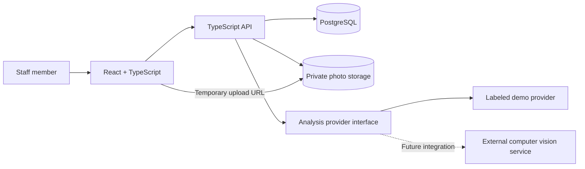

# Solar inspection portal — project proposal

## Purpose and scope

Build a React frontend and TypeScript backend for an energy company's solar panel inspection workflow. Staff upload photos, review findings, and record inspection decisions.

This proposal covers application development only. Model training, image inference infrastructure, drone integration, and thermal analysis are outside the delivery scope. An adapter allows a future computer vision service to supply findings. Until connected, sample findings are explicitly marked as demo data; the application does not claim to detect defects.

Assumptions: one company, multiple solar sites, staff users, JPEG/PNG uploads, and manual association of photos with sites and optional panel identifiers. Confirm image volumes and existing company authentication before production sizing.

## User workflow

1. Sign in and select a solar site.
2. Create an inspection with its date, description, and optional panel references.
3. Upload photos and view processing status.
4. Review photo overlays and finding details. Findings may be entered manually, supplied by an integrated service, or shown in an explicitly labeled demo mode.
5. Accept, reject, or correct a finding; assign review priority and add notes.
6. Complete the inspection and export a CSV report.

## Frontend

Use React, TypeScript, and Vite, with React Router for navigation and TanStack Query for API data. Keep the design responsive for desktop review and tablet use in the field.

| Screen | Main behavior |
| --- | --- |
| Dashboard | Inspection counts, pending reviews, recent activity |
| Sites | Site list and site inspection history |
| New inspection | Metadata form, photo upload, progress and retry |
| Inspection workspace | Photo gallery, zoomable photo viewer, normalized bounding-box overlays |
| Finding review | Suggested label, model score when available, review decision, priority and notes |
| Reports | Filter completed inspections and download CSV |

Handle loading, empty, failed-upload, processing, and unavailable-analysis states. Photo overlays must stay aligned when zooming or resizing. Expose findings through an accessible list as well as overlays.

## Backend

Use Node.js and TypeScript with Fastify, PostgreSQL, and Prisma. Use private S3-compatible object storage for photos and an existing OIDC identity provider for staff sign-in. Local development can use PostgreSQL and MinIO in Docker Compose with a development-only identity stub.

Keep one API application with modules for sites, inspections, uploads, findings, and reporting. A separate worker is deferred until a real asynchronous analysis provider requires it.



The backend authorizes uploads, issues short-lived upload URLs, verifies uploaded objects, and stores photo metadata. Clients upload directly to object storage. S3 supports scoped uploads using presigned URLs: [AWS documentation](https://docs.aws.amazon.com/AmazonS3/latest/userguide/using-presigned-url.html).

Enforce access checks on every inspection, photo, and finding request. Validate file type using file contents, impose configurable byte and decoded-pixel limits, and generate unique server-controlled object keys. Keep original photos private and authorize temporary download URLs.

## Data model

| Entity | Key fields |
| --- | --- |
| User | ID, external identity subject, name, role |
| Site | ID, name, location |
| Inspection | ID, site ID, creator ID, date, status, notes |
| Photo | ID, inspection ID, object key, dimensions, upload status, optional panel reference |
| AnalysisRun | ID, photo ID, provider, model version, status, external job ID, error |
| Finding | ID, photo ID, optional run ID, label, normalized bounding box, optional model score, source |
| Review | ID, finding ID, reviewer ID, decision, corrected label, priority, notes, timestamp |

Preserve suggested findings separately from human reviews. Sources are `manual`, `demo`, or `model`. Model score and maintenance priority are separate fields. A photo without findings means “no findings recorded,” not confirmation that the panel is defect-free.

## API outline

| Method and route | Purpose |
| --- | --- |
| `GET /api/sites` | List sites |
| `POST /api/sites` | Create a site, manager role |
| `GET /api/inspections` | Filter and paginate inspections |
| `POST /api/inspections` | Create an inspection |
| `GET /api/inspections/:id` | Read inspection details |
| `PATCH /api/inspections/:id` | Update metadata or complete an inspection |
| `POST /api/inspections/:id/uploads` | Register a photo and request an upload URL |
| `POST /api/photos/:id/complete-upload` | Verify upload completion |
| `GET /api/photos/:id` | Read photo metadata, authorized image URL, and findings |
| `POST /api/photos/:id/findings` | Add a manual finding |
| `POST /api/photos/:id/analysis` | Request configured provider analysis |
| `GET /api/analysis-runs/:id` | Read analysis status |
| `POST /api/findings/:id/reviews` | Record a human review |
| `GET /api/inspections/:id/report.csv` | Export an authorized inspection report |

Validate requests and responses with shared schemas. Analysis requests accept idempotency keys. Use explicit `queued`, `processing`, `completed`, and `failed` run states, with bounded polling in the UI. Keep live integration credentials on the backend.

## Computer vision integration boundary

Define an `AnalysisProvider` interface with `submit(photo)` and `getStatus(jobId)`. Results include photo ID, model version, findings, labels, bounding boxes, and optional scores. Validate provider responses before storing them and retain the run identity to prevent duplicate findings.

For development, the demo provider returns deterministic fixtures only for bundled sample photos. Arbitrary uploaded photos remain available for manual review and show “Automated analysis not connected.” Never generate invented detections for user uploads.

The application's initial finding vocabulary can include visible damage, soiling, and discoloration, subject to company review. Future thermal findings need a distinct image modality and provider capability. Inspection techniques expose different evidence; the interface must identify the image modality rather than implying ordinary photos establish electrical health. Reference: [NREL operation and maintenance guidance](https://www.nrel.gov/docs/fy19osti/73822.pdf).

## Suggested repository

```text
apps/
  web/                 React application
  api/                 TypeScript API and provider adapters
packages/
  contracts/           Shared request, response, and validation schemas
prisma/                Database schema and migrations
fixtures/              Licensed sample images and demo findings
docs/                  API and local setup notes
compose.yaml           Local PostgreSQL and object storage
```

## Delivery plan

1. Foundation: repository setup, shared schemas, database, navigation, local identity, and sample sites.
2. Inspection workflow: create inspections, upload and retrieve photos, handle failures, and persist metadata.
3. Review workspace: photo overlays, manual findings, demo adapter, review decisions, and audit history.
4. Delivery: dashboard, CSV export, authorization checks, deployment configuration, and setup documentation.

Indicative effort: 3–5 developer weeks for one experienced full-stack developer, assuming a single-company workflow, straightforward identity integration, and no live model integration. This is a planning estimate; company requirements and the hosting environment can change it.

## Acceptance criteria

- Staff can create an inspection, upload photos, and reopen persisted results.
- Invalid uploads fail clearly, and interrupted uploads can be retried.
- Findings and overlays remain aligned across image sizes and zoom levels.
- Demo results are visibly labeled and limited to sample photos.
- Manual review works without an analysis service.
- Review decisions retain reviewer identity and timestamps.
- Unauthorized requests cannot access photos, inspections, or exports.
- CSV exports match the stored review decisions and distinguish demo data.
- API tests cover permissions, upload verification, state transitions, and provider failure handling. One end-to-end test covers creation through review and export.

## Decisions to settle before implementation

Confirm company branding, identity provider, hosting environment, expected photo volume, image retention requirements, and whether the first release needs a real external analysis provider. None is needed to begin a local prototype with sample data.
