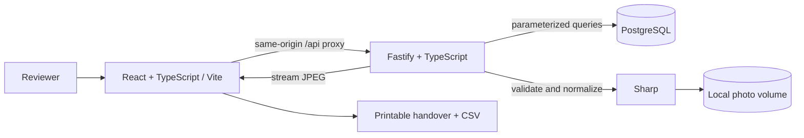

# Implementation architecture

Fieldwork is a single-company, local installation quality module for a renewable installer workflow. It implements projects, inspections, photos, findings, human review, resolution, and handover. CRM, sales, installation scheduling, model training, and Reonic integration are outside its current scope.

## State and consistency

TanStack Query handles API cache state; successful mutations invalidate active queries. Checklist changes update immediately while saving and revert on failure. Photo selection, zoom, and unfinished drawing coordinates remain in React state. React Router makes projects, inspections, and handover documents directly addressable. Each inspection records an assigned installer as a local text field; this does not create an account or notify anyone.

Bounding boxes use normalized coordinates relative to the stored, orientation-normalized image. Both the interactive viewer and printable report position overlays as percentages. Zoom changes the image and overlay container together. Whole-photo findings provide a keyboard alternative to pointer drawing.

All inspection edits acquire a PostgreSQL row lock on the parent inspection. This serializes review changes, checklist changes, uploads, and completion. Completion checks photo presence, the latest decision for every finding, resolution of confirmed issues, and the full checklist within the same transaction. Completed inspections reject subsequent edits until explicitly reopened.

The `reviews` table is append-only. A sequence identifies the latest review deterministically. The `audit_events` table retains inspection activity, including the previous resolution event when a new review clears current resolution. The reviewer identity is a local development constant, not authentication.

## Uploads and storage

The API accepts one file per multipart request, up to 15 MB. Sharp examines image contents rather than trusting MIME labels or filenames, rejects formats other than JPEG/PNG, caps decoded pixels, normalizes EXIF orientation, and removes original metadata by re-encoding as JPEG. Original image files are not retained; this is suitable for the prototype, not a forensic archive.

Files use generated UUID keys. A photo record is committed only after its file is written; a failed database transaction removes the new file. A process crash between file write and database commit can still leave an unreferenced file; a production storage adapter needs reconciliation and retention policies. Files are served by photo ID, not an arbitrary path.

Image bytes live in a Docker volume and metadata lives in PostgreSQL. Preserve and back up both together. The development API has no authorization; loopback bindings limit exposure on the host.

## API

All JSON errors use `{ "message": "..." }`. Input validation returns 400; absent resources return 404; editing a completed inspection or attempting an invalid completion returns 409. Unexpected internal errors return a generic 500 message, with details in server logs.

| Method | Route | Behavior |
| --- | --- | --- |
| GET | `/api/health` | Database health and local/analysis mode |
| GET/POST | `/api/sites` | List or create customer projects |
| GET | `/api/dashboard` | Counts and six recent inspections |
| GET | `/api/inspections` | Search, status/site filter, limit and offset |
| POST | `/api/inspections` | Create inspection |
| GET | `/api/inspections/:id` | Inspection, photos, findings, latest reviews |
| GET | `/api/inspections/:id/activity` | Up to 50 recent audit events |
| PATCH | `/api/inspections/:id/checklist` | Update all three checklist values |
| PATCH | `/api/inspections/:id/status` | Complete or reopen |
| POST | `/api/inspections/:id/photos` | Upload and normalize one image |
| GET | `/api/photos/:id/file` | Stream stored JPEG |
| POST | `/api/photos/:id/findings` | Add a manual observation |
| POST | `/api/findings/:id/reviews` | Append review decision |
| PATCH | `/api/findings/:id/resolution` | Resolve or reopen a confirmed issue |
| GET | `/api/inspections/:id/report.csv` | CSV export with source and review data |

CSV values are quoted, embedded quotes are escaped, and formula-like cells are prefixed to prevent spreadsheet execution. The report labels demo data and unreviewed findings. The browser handover page renders all photos and observations; print CSS removes navigation and supports saving through the browser's PDF option.

## Future analysis provider

No inference service is called, and no fake detections are generated for uploads. The seed inserts demo findings only for bundled synthetic illustrations.

When a real provider is selected, add a backend adapter with `submit(photo)` and `getStatus(jobId)` methods plus persisted analysis runs. Keep API credentials on the server. An analysis run should retain a model version, image modality, provider job ID, state, and failure details. Validate output boxes and labels using shared contracts before accepting findings with `source=model`. Use idempotent delivery and bounded retries. A queue is warranted when the selected provider needs background jobs; it is not required for the current manual workflow.

The database already separates finding source, optional model score/version, review decision, maintenance priority, and resolution. A real integration must evaluate model quality on representative data before enabling operational use; no accuracy claim is made here.
