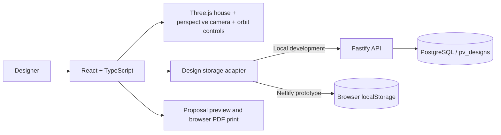

# Design & Propose architecture

The visible prototype is a single solar design workflow. Local development uses the existing Fastify API and PostgreSQL; the Netlify prototype saves designs in the visitor's browser. The inspection records and backend routes are preserved.

## Roof interaction

The house and modules are built from Three.js meshes. A perspective camera and OrbitControls provide full azimuth rotation with elevation limits above the ground. Mouse dragging, touch gestures, scroll zoom, camera presets, keyboard rotation, and reset use the same camera target. Frame rendering occurs on interaction, resizing, or layout changes rather than through a continuous animation loop.

The main roof defines 30 cells in world coordinates. Module meshes, cell outlines, and interaction targets all derive from those coordinates. The targets project through the current camera onto an accessible SVG overlay and are hidden when the main roof faces away. Pointer gestures distinguish a click from a drag so orbiting never adds panels accidentally. Each visible section remains a keyboard-focusable toggle button.

The interactive renderer uses WebGL with lighting and shadows. If WebGL is unavailable, it shows the earlier single house image with aligned roof controls and explicitly labels the view as fixed. Orbit controls and camera presets are unavailable in that fallback. The proposal captures its rendered WebGL view as a print-safe PNG, using the same geometry and camera. If WebGL is unavailable, the proposal uses the fixed house image with the saved panel overlay. Resize observers, controls, animation requests, geometries, materials, and renderer resources are cleaned up on unmount. No external 3D model download is required; the fixed-view fallback image is included locally.

The geometry is illustrative, not a measured site survey. The earlier generated house image is retained for browsers without WebGL.

React holds unsaved design state and a panel-layout undo history. Shared calculations derive capacity, illustrative annual generation, and the itemized price from selected slots and module wattage. No image segmentation, solar simulation, external model, or CV service is invoked.

## Persistence

`apps/web/src/design-store.ts` chooses persistence from the build-time `VITE_DESIGN_STORAGE` setting. Netlify sets it to `browser`: reads and writes use localStorage without `/api` requests. Stored documents pass the shared schema, carry a revision and timestamp, and reject saves based on a stale revision. Storage failures remain visible and do not mark unsaved changes as saved. Browser saves belong to that browser and device, and clearing site data removes them. The UI states **Saved in this browser** and explains storage in the help dialog.

The default mode uses the API. It does not fall back to browser storage on network or server errors. The API client checks response types and reports HTML routing failures clearly, rather than exposing a browser-specific JSON parsing error.

`GET /api/design` returns the saved design or `null` for a new workspace. `PUT /api/design` validates the project details, a unique list of roof indices (0–29), supported wattage, and expected revision.

The local prototype has one shared design record. Saving acquires a transaction-scoped advisory lock, compares the expected revision with the stored version, then inserts or updates. A successful response includes the new revision and timestamp. A stale revision returns 409 and the UI offers to load the latest saved layout. Validation errors return 400. Parameterized queries keep user-entered project details separate from SQL.

The `003_pv_designs.sql` migration adds a JSONB document table without altering inspection data. PostgreSQL remains in the existing persistent Docker volume. No new cloud account or service is required.

## Proposal generation

Generating a proposal first saves unsaved changes. The preview uses the saved layout and the same 3D house geometry, displays customer details, includes the module count and system capacity, and itemizes modules, inverter, and installation. Print CSS removes app navigation and controls so the browser can print or save a PDF.

All values are concept assumptions declared in `packages/contracts/src/index.ts` and the proposal footer. There is no binding quote, customer signature, external send action, or inferred engineering accuracy.

## Validation

API tests cover layout persistence, invalid and duplicate roof indices, module settings, and stale-save rejection, alongside the retained inspection API tests. Browser tests cover mouse and keyboard placement, removal and undo, changing module wattage, saving and reloading, proposal generation, print visibility, perspective orbit without accidental panel edits, camera presets, keyboard rotation, zoom, and mobile overflow.

`playwright.static.config.ts` checks the production browser-storage build in Chromium and WebKit, including reloads, proposal generation with no API requests, stale tabs, and failed writes. The API-mode browser tests also reproduce an HTML API response and verify the readable deployment error.

Before publicly deploying the API, replace the local shared workspace with authenticated, authorized customer projects. The existing API remains bound to loopback and refuses production mode. The public Netlify prototype uses browser storage instead.
